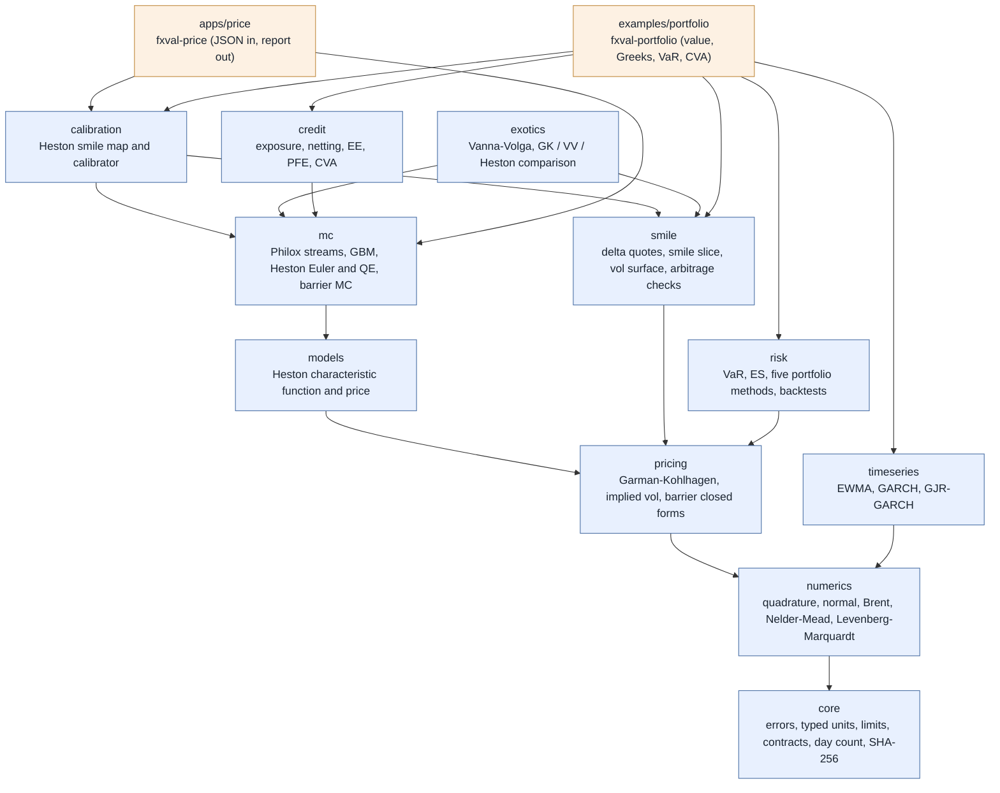
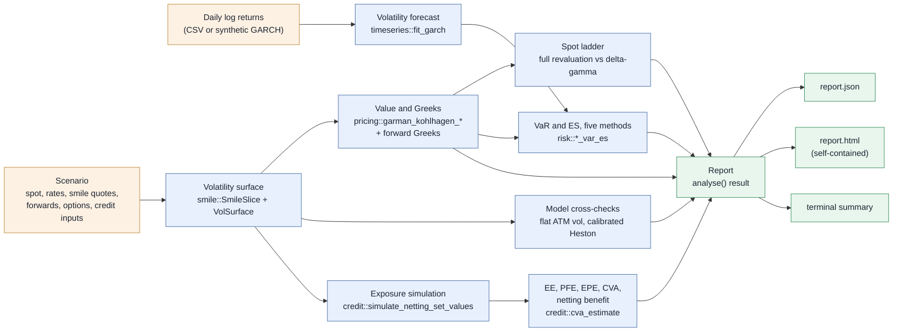
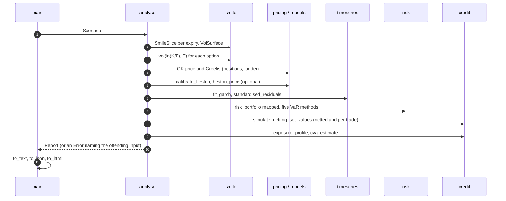

# Architecture

Status: release 1.0. All layers below exist: `core`, `numerics`, `pricing`, `models` (Heston), `mc`, `smile`, `calibration`, `exotics`, `timeseries`, `risk` and `credit`, the command-line program `fxval-price` in `apps`,
and the example application `fxval-portfolio` in `examples/portfolio`. The diagrams in the next section are drawn from the actual `#include` lines of the library (checked when they were written); the layer list after them is the
rule they must satisfy.

## Diagrams

### Library modules and their direct dependencies

An arrow means "includes headers of". Only the direct dependencies that are not implied by another path are drawn (for example
`mc` depends on `pricing` through `models`). Everything depends on `core`, which is not drawn for that reason.



### The portfolio application: data flow



### One run of `analyse()`



## Layers and dependency rule

Each layer may depend only on layers above it in this list. Nothing depends on `apps`.

```
core          errors, typed units, day count, limits, contracts    (implemented)
numerics      adaptive quadrature (week 3), normal quantile (week 7),
              Brent root finder, Levenberg-Marquardt (week 8)      (implemented)
pricing       Garman-Kohlhagen (Greeks), implied volatility (week 8); barrier, touch and double no-touch closed forms and the contract types (week 9); Black-76 later
models        semi-analytic Heston (implemented, week 3)           (week 3)
mc            engine, random streams, GBM, Heston Euler FT and QE, variance reduction, barrier Monte Carlo with Brownian bridge  (implemented, weeks 4-5, 9)
              QE scheme, variance reduction (planned)              (week 5)
smile         delta quotes, interpolation, arbitrage checks        (implemented, week 7)
calibration   Heston smile maps, Heston calibrator                 (implemented, week 8)
exotics       Vanna-Volga, GK / Vanna-Volga / Heston comparison    (implemented, week 9)
instruments   FX forward, FX option, portfolio                     (weeks 9-11)
timeseries    EWMA, GARCH, GJR-GARCH                               (implemented, week 10)
risk          VaR, ES, portfolio methods, backtests                (implemented, week 10)
credit        exposure, netting, EE, PFE, CVA                      (implemented, week 11)
apps          fxval-price (implemented, week 6); more programs     (week 6 onward)
              not part of the public API; the only code that uses a JSON parser
examples      smile scenarios (week 7), fxval-portfolio (release 1.0): use only the public API;
              fxval-portfolio writes its JSON by hand and needs no JSON parser
```

The dependency rule will be enforced by directory-level `target_link_libraries` once the library
is split into more than one target. Until then it is a review rule.

## Rules that apply everywhere

* **Errors:** see `docs/adr/0001-error-policy.md`. Boundary functions return `Result<T>`;
  inner-loop kernels are `noexcept` and take validated types.
* **Units:** raw `double` does not cross a public API when a typed unit exists.
* **Immutability:** models and instruments are immutable after construction. Const member
  functions are safe to call from several threads at once (documented per class).
* **Determinism:** no global state, no `rand()`, explicit seeds, no fast-math. Results must not
  depend on the number of threads (test V-07).
* **Extension:** a new simulation scheme is a new class that satisfies the `PathModel` concept
  (`mc/engine.hpp`); the engine is not edited (open for extension, closed for modification).
* **Dispatch:** static dispatch (templates and concepts) inside Monte Carlo inner loops, runtime
  polymorphism only at instrument boundaries.

## Testing layout

* `tests/unit/`: behaviour of the library's own code.
* `tests/validation/`: the V-series (see `docs/test_catalogue.md`), which is evidence about the
  models and appears in the validation report.
* `tests/app/`: the command-line layer (configuration, runner, reports, CLI, metadata), and the
  allocation test (`fxval_alloc_tests`, a program of its own because it replaces `operator new`).
* `tests/regression/`: frozen results of the example configurations; checked against independent
  Python code by `python/tests/test_price_examples.py`.
* `tests/integration/run_cli.cmake`: end-to-end test of the real executable (exit codes, files,
  config hash against CMake's own SHA-256).
* `python/tests/`: data download parsers, run offline.

## Provenance

Every report written by `fxval-price` carries the git commit, the SHA-256 of the input
configuration, the random seed, the compiler and the library version (ADR 0007). The data download
script already writes a `.meta.json` next to each CSV with source URL, retrieval time and a hash.
